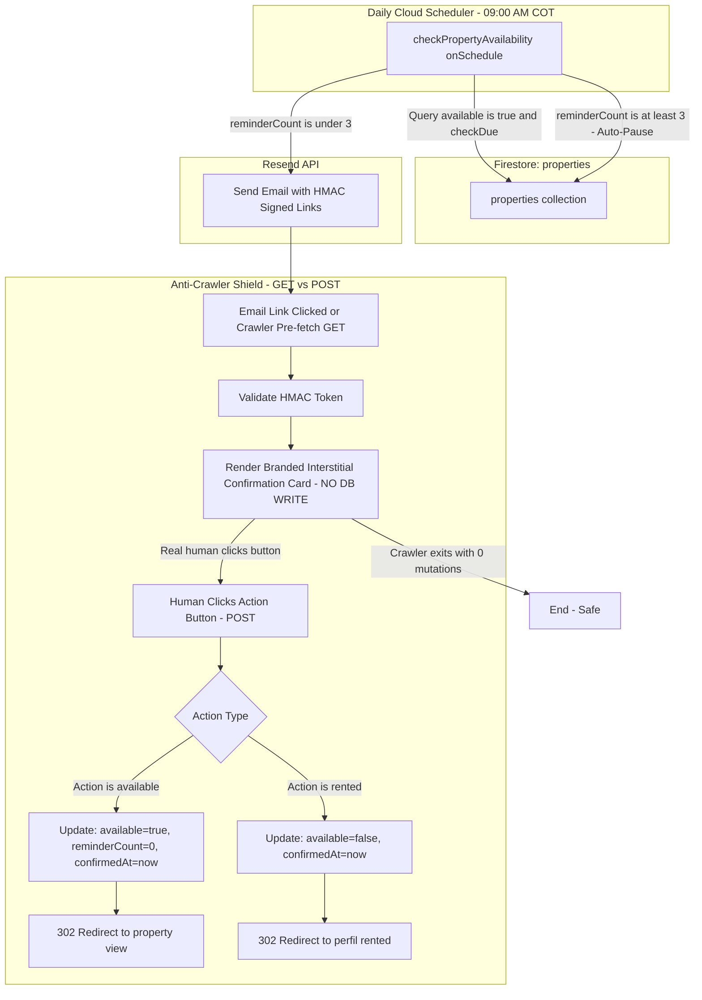

> **SISTEMA RETIRADO.** Esta documentación es histórica. El sitio publicado es estático; ver [README](../README.md) para el apagado de las funciones que sigan desplegadas.

# Property Availability Confirmation & Mailing Architecture

## 1. System Overview

This feature automates periodic availability verification for active rental listings on **Una Casita**. It periodically prompts landlords via email to confirm whether their property is still available or has been rented out, and gracefully auto-pauses listings that remain inactive.



---

## 2. Core Architectural Invariants

### AD-1 — Daily Scheduled Batch Processing
- **Rule:** A single daily scheduled Cloud Function (`checkPropertyAvailability`) executes once every morning at `09:00 America/Bogota` (COT).
- **Behavior:** Queries active listings (`available == true`) where `lastAvailabilityCheckAt <= (now - 7 days)` (or `createdAt <= (now - 7 days)` for the first check).

### AD-2 — 7-Day Rolling Cadence & 21-Day Auto-Pause Policy
- **Rule:** Availability checks occur every 7 rolling days.
- **Auto-Pause:** If an owner leaves 3 consecutive weekly reminders unanswered (`availabilityReminderCount >= 3`), the scheduler automatically sets `available: false`, records `autoPausedAt: serverTimestamp()`, and sends an auto-pause notification email.

### AD-3 — Stateless HMAC-SHA256 Token Security
- **Rule:** Action links in emails are authenticated via stateless HMAC-SHA256 signatures derived from `propertyId` + `ownerId` signed with `RESEND_API_KEY`.
- **Security:** Prevents ID tampering and parameter enumeration without requiring database-stored temporary tokens.

### AD-4 — Two-Phase Anti-Crawler Shield (GET Safe / POST Mutates)
- **HTTP GET (Strictly Read-Only):** When email security scanners (e.g., SafeLinks, Barracuda) or users open the email link, the endpoint validates the signature and returns a branded HTML confirmation card. **Zero database writes occur on GET.**
- **HTTP POST (State Mutation):** When a human clicks the confirmation button on the card, the form submits via `POST`, executing the atomic Firestore update and redirecting to the application.

---

## 3. Data Schema Extensions (`properties` collection)

| Field | Type | Description |
| :--- | :--- | :--- |
| `available` | `boolean` | Indicates whether the listing is visible in active search. |
| `lastAvailabilityCheckAt` | `Timestamp` | Timestamp when the last reminder email was dispatched. |
| `lastAvailabilityConfirmedAt` | `Timestamp` | Timestamp when the landlord confirmed availability via human POST. |
| `availabilityReminderCount` | `number` | Counter of consecutive unanswered reminders (0, 1, 2, 3). Resets to 0 upon confirmation. |
| `autoPausedAt` | `Timestamp` | Timestamp recorded when the listing was automatically deactivated after 3 unanswered reminders. |

---

## 4. File Catalog & Responsibilities

| File Path | Component / Layer | Responsibility |
| :--- | :--- | :--- |
| [`functions/src/index.ts`](../functions/src/index.ts) | Cloud Functions Root | Public deployment catalog exporting `checkPropertyAvailability` (scheduler) and `confirmAvailability` (HTTPS endpoint). |
| [`functions/src/utils.ts`](../functions/src/utils.ts) | Backend Utilities & Security | Single source of truth for labels, HMAC generator (`generateAvailabilitySignature`), URL constructor (`getActionUrl`), formatters, and secrets. |
| [`functions/src/checkPropertyAvailability.tsx`](../functions/src/checkPropertyAvailability.tsx) | Scheduled Engine | Daily cron function (09:00 COT) that runs the batch query, evaluates 7-day eligibility, dispatches emails, and manages the 3-strike auto-pause lifecycle. |
| [`functions/src/confirmAvailability.ts`](../functions/src/confirmAvailability.ts) | HTTPS Action Handler | Handles passwordless email links. Serves the read-only GET preview card (anti-crawler defense) and processes POST mutations with HTTP 302 redirects. |
| [`functions/src/emails/property-availability-check.tsx`](../functions/src/emails/property-availability-check.tsx) | React Email Template | Production email template for the 7-day availability check with "Sí, sigue disponible" and "Ya la alquilé" action buttons. |
| [`functions/src/emails/property-auto-paused.tsx`](../functions/src/emails/property-auto-paused.tsx) | React Email Template | Production email template notifying the owner that their listing was paused for inactivity with a reactivation link. |
| [`functions/src/emails/house-published.tsx`](../functions/src/emails/house-published.tsx) | React Email Template | Initial publication confirmation email (updated footer mentioning 7-day reminder cadence). |
| [`react-email-starter/emails/`](../react-email-starter/emails) | Design Workbench | Local preview environment (`email dev`) synced with all current email templates for visual testing. |
| [`src/types/index.ts`](../src/types/index.ts) | Shared Client Types | Extends `Property` interface with availability tracking timestamps and reminder counter. |
| [`functions/.secret.local`](../functions/.secret.local) | Local Secret Config | Local environment secret configuration file storing `RESEND_API_KEY` for the Firebase Functions emulator. |
| [`scripts/test-availability.ts`](../scripts/test-availability.ts) | Local Test Automation | Script that seeds test scenarios into the Firestore emulator and generates signed test URLs. |
| [`scripts/trigger-check.ts`](../scripts/trigger-check.ts) | Local Execution Helper | Triggers the availability check batch execution against the local emulator without requiring `firebase login`. |

---

## 5. Secret Management & Emulator Environment

1. **Production:** `RESEND_API_KEY` is securely injected via Google Cloud Secret Manager using `defineSecret("RESEND_API_KEY")`.
2. **Local Emulator:** Firebase CLI automatically loads secrets from `functions/.secret.local`. Test scripts dynamically resolve this secret file to guarantee cryptographic signature parity.
3. **Safe Sandbox Recipient:** When running in the emulator (`FUNCTIONS_EMULATOR=true`), all emails are routed to `delivered@resend.dev` to prevent delivering test messages to real user inboxes.

---

## 6. Testing Matrix

| ID | Scenario | Precondition / Input State | Trigger / Action | Expected Result | Verification Check |
| :--- | :--- | :--- | :--- | :--- | :--- |
| **TC-01** | **7-Day Reminder Dispatch (Happy Path)** | Active property published 8 days ago (`available: true`, `reminderCount: 0`). | Run `checkPropertyAvailability` cron. | 1. Sends `PropertyAvailabilityCheckEmail` to owner (or `delivered@resend.dev`).<br/>2. Sets `lastAvailabilityCheckAt = now`.<br/>3. Increments `availabilityReminderCount = 1`. | Check Firestore doc & function terminal logs. |
| **TC-02** | **Skip Recent Listing (< 7 Days)** | Active property published 2 days ago (`lastAvailabilityCheckAt <= 2 days`). | Run `checkPropertyAvailability` cron. | Property is skipped. No email sent, no timestamps altered. | Firestore doc untouched. |
| **TC-03** | **3-Strike Auto-Pause (21 Days Inactive)** | Active property with `availabilityReminderCount = 3` and last check > 7 days ago. | Run `checkPropertyAvailability` cron. | 1. Mutates `available = false`.<br/>2. Records `autoPausedAt = now`.<br/>3. Sends `PropertyAutoPausedEmail`. | Check Firestore: `available: false`, check email log. |
| **TC-04** | **Anti-Crawler GET Pre-fetch (Zero Writes)** | Valid email action link (`GET /confirmAvailability?pid=...&action=available&sig=...`). | Browser or bot visits the URL via `GET`. | Returns 200 HTML with branded confirmation card. **ZERO database mutations.** | Verify Firestore doc is identical before and after GET. |
| **TC-05** | **Human Confirms "Sí, sigue disponible"** | User sees the GET confirmation card and clicks the button. | Form submits `POST /confirmAvailability` with `action=available`. | 1. Sets `available = true`.<br/>2. Resets `availabilityReminderCount = 0`.<br/>3. Sets `lastAvailabilityConfirmedAt = now`.<br/>4. HTTP 302 Redirect to `/property/:id/view?availabilityConfirmed=true`. | Browser redirects to listing page; Firestore resets counter. |
| **TC-06** | **Human Confirms "Ya la alquilé"** | User opens `action=rented` link and clicks `"Sí, marcar como alquilada"`. | Form submits `POST /confirmAvailability` with `action=rented`. | 1. Sets `available = false`.<br/>2. Sets `lastAvailabilityConfirmedAt = now`.<br/>3. HTTP 302 Redirect to `/perfil?status=rented`. | Browser redirects to profile; listing is no longer available in search. |
| **TC-07** | **Tampered Signature / ID Spoofing** | URL with modified `pid` or corrupted `sig`. | `GET` or `POST /confirmAvailability`. | 403 Forbidden ("Firma inválida o enlace no autorizado"). No DB write. | HTTP 403 response. |
| **TC-08** | **Non-Existent Property ID** | URL with non-existent `pid`. | `GET` or `POST /confirmAvailability`. | 404 Not Found ("La propiedad no fue encontrada"). | HTTP 404 response. |

---

## 7. Local Testing Guide

### 1. Start Local Emulators
```bash
npm run dev
```

### 2. Seed Test Scenarios
In a separate terminal, seed mock test listings into the emulator:
```bash
npx tsx scripts/test-availability.ts
```

### 3. Trigger the Availability Check
Execute the batch checker against your running emulator:
```bash
npx tsx scripts/trigger-check.ts
```

### 4. Test Action Links in Browser
Open the signed links output by `scripts/test-availability.ts` in your browser:
* **GET preview card:** Verify that opening the link displays the property summary without altering the database.
* **POST confirmation:** Click the confirmation button to verify the Firestore update and automatic application redirect.
